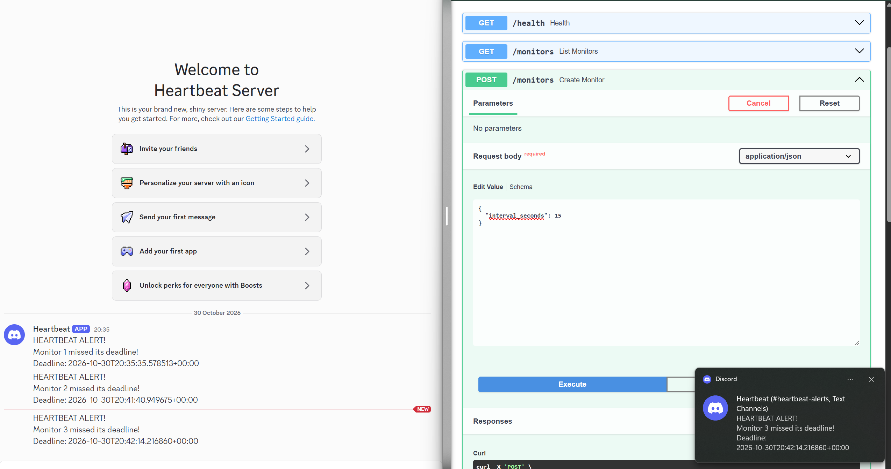

# Heartbeat - A Dead Man's Switch

> A Python-based check-in monitoring system that tracks scheduled deadlines, detects missed check-ins, and automatically sends Discord notifications — built using FastAPI, SQLite, and a background worker with persistent alert logging.


---

## Overview

Heartbeat is a backend monitoring system designed to detect when expected check-ins fail to occur. Users can create monitors with configurable intervals, retrieve existing monitors, and reset their deadlines through API requests.

A separate background worker periodically checks for overdue monitors and sends notifications through Discord webhooks when deadlines are missed. SQLite provides persistent storage for monitors and alerts, while database constraints prevent duplicate alert records for the same missed deadline.

The project explores practical software engineering concepts including REST API design, background processing, database persistence, automated testing, and event-driven workflows.

Potential applications include personal accountability, scheduled task monitoring, service health checks, and automated workflows.

---

## Demo

The demonstration shows a monitor being created through FastAPI, followed by an automatic Discord notification when its deadline expires.



[Watch the Heartbeat Demo](assets/heartbeat-demo.mp4)

---

## Core Features

| Feature | Description |
|---|---|
| Monitor Creation | Create monitors with configurable check-in intervals |
| Check-in System | Reset existing monitor deadlines through API requests |
| Persistent Storage | Store monitors and alert records using SQLite |
| Background Worker | Automatically check for overdue monitors every 5 seconds |
| Deadline Detection | Identify monitors whose check-in deadlines have expired |
| Discord Notifications | Send webhook notifications when missed deadlines are detected |
| Duplicate Prevention | Prevent repeated alert records using database uniqueness constraints |
| Automated Testing | Verify check-in behaviour, deadline detection, and duplicate alert handling |

---

## Architecture

| Component | Role |
|---|---|
| `main.py` | FastAPI application handling HTTP requests, input validation, and responses |
| `database.py` | SQLite operations, monitor management, deadline updates, and alert records |
| `worker.py` | Background process that periodically checks for overdue monitors |
| `notifier.py` | Sends notifications through Discord webhooks |
| `tests/` | Automated tests verifying core functionality |

The API and background worker operate as separate processes while sharing the same SQLite database.

This separation allows incoming API requests to be handled independently of deadline monitoring, improving modularity and maintainability.

### System Workflow

1. A monitor is created through the FastAPI REST API with a specified check-in interval.
2. The monitor's deadline is calculated using UTC and stored in SQLite.
3. A user can check in through the API to reset the deadline.
4. The background worker checks the database every five seconds for overdue monitors.
5. When a missed deadline is detected, the worker attempts to record a new alert.
6. A database uniqueness constraint prevents duplicate records for the same monitor and deadline.
7. Newly recorded alerts trigger Discord webhook notifications.

---

## Getting Started

### Prerequisites

- Python 3.10+
- pip
- Discord server and webhook (for notifications)

### Installation

```powershell
# 1. Clone the repository
git clone https://github.com/TobiOparinde/heartbeat-deadman-switch.git
cd heartbeat-deadman-switch

# 2. Create a virtual environment
python -m venv .venv

# 3. Activate the environment (Windows PowerShell)
.\.venv\Scripts\Activate.ps1

# 4. Install dependencies
python -m pip install -r requirements.txt

# 5. Start the FastAPI server
python -m fastapi dev main.py
```

Open the interactive API documentation:

`http://127.0.0.1:8000/docs`

### Running the Background Worker

Configure a Discord webhook URL as an environment variable.

Open a second PowerShell terminal:

```powershell
# 1. Activate the virtual environment
.\.venv\Scripts\Activate.ps1

# 2. Configure the Discord webhook
$env:DISCORD_WEBHOOK_URL = "YOUR_WEBHOOK_URL"

# 3. Start the background worker
python worker.py
```

The worker continuously checks for expired deadlines and sends notifications when new missed check-ins are detected.

The webhook URL should be kept private and never committed to version control.

---

## API Endpoints

| Method | Endpoint | Description |
|---|---|---|
| GET | `/health` | Check API availability |
| POST | `/monitors` | Create a monitor with a specified interval |
| GET | `/monitors` | Retrieve stored monitors |
| POST | `/monitors/{monitor_id}/check-in` | Reset an existing monitor's deadline |

### Example: Creating a Monitor

**Request**

```json
{
  "interval_seconds": 3600
}
```

**Example Response**

```json
{
  "id": 1,
  "interval_seconds": 3600,
  "deadline": "2026-10-30T15:00:00+00:00"
}
```

This creates a monitor requiring a check-in every 3600 seconds (1 hour).

When a successful check-in occurs, the deadline is recalculated using the current UTC time and the configured interval.

If the deadline passes without a check-in, the background worker detects the overdue monitor and attempts to trigger a Discord notification.

---

## Project Structure

```text
heartbeat-deadman-switch/
├── main.py               # FastAPI endpoints and validation
├── database.py           # SQLite database operations
├── worker.py             # Background deadline monitoring
├── notifier.py           # Discord webhook integration
├── tests/
│   ├── test_alerts.py    # Duplicate alert tests
│   └── test_checkin.py   # Check-in and deadline tests
├── assets/
│   ├── heartbeat-demo.png
│   └── heartbeat-demo.mp4
├── requirements.txt      # Python dependencies
├── .env.example          # Example webhook configuration
├── .gitignore
└── README.md
```

The SQLite database and local environment configuration are excluded from version control.

---

## Testing

Heartbeat uses pytest to verify core application behaviour.

The automated tests cover:

- **Duplicate Alert Prevention:** Ensures the same missed deadline cannot create multiple alert records.
- **Deadline Reset:** Confirms that checking in updates a monitor's deadline correctly.
- **Overdue Detection:** Verifies that monitors with expired deadlines are correctly identified.
- **Invalid Monitor Handling:** Ensures check-ins for nonexistent monitors are handled appropriately.

Run the test suite:

```powershell
python -m pytest -v
```

Tests use temporary SQLite databases to avoid modifying application data.

---

## Tech Stack

- **Python** — application logic, datetime operations, and background processing
- **FastAPI** — REST API development and interactive API documentation
- **SQLite** — persistent monitor and alert storage
- **Pydantic** — request validation
- **Requests** — HTTP integration with Discord webhooks
- **pytest** — automated testing

---

## Engineering Decisions

**Modular Architecture:** API handling, database operations, background monitoring, and notifications are separated into individual modules, promoting high cohesion and loose coupling.

**Persistent Storage:** SQLite ensures monitor deadlines and alert records survive application restarts, avoiding the loss of information stored only in memory.

**Background Processing:** A separate worker periodically polls the database, allowing deadline monitoring to operate independently of API requests.

**Duplicate Prevention:** A composite unique constraint on monitor IDs and deadlines prevents repeated alert records for the same missed check-in. This provides database-enforced idempotency for alert creation.

**Input Validation:** Pydantic ensures monitor intervals are valid before processing, rejecting invalid requests automatically.

**UTC Timestamps:** Deadlines are stored using UTC timestamps to maintain consistent time calculations.

---

## Future Extensions

Heartbeat v0.1 provides a functional foundation for monitoring scheduled check-ins. Potential areas for further engineering exploration include:

| Area | Potential Improvements |
|---|---|
| Reliability | Notification retries, delivery tracking, and fault recovery |
| Scalability | PostgreSQL migration, concurrent workers, and distributed task queues |
| Security | Authentication, authorisation, and multi-user support |
| Deployment | Docker containerisation, cloud hosting, and system observability |
| Integrations | Additional notification channels and custom webhook actions |

These are potential architectural directions rather than requirements for the current prototype.

### Current Limitations

Heartbeat is currently designed as a local prototype rather than a production-grade monitoring service.

Notification delivery failures are not automatically retried, and further safeguards would be required to handle concurrent check-ins, worker failures, and reliable message delivery at scale.

---

## Project Status

**v0.1 - Functional Prototype**

Core REST API functionality, persistent check-ins, automated deadline detection, duplicate alert recording, Discord notifications, and initial automated tests have been implemented.

The project demonstrates a working foundation for a broader monitoring and notification system, with opportunities for further development in reliability, scalability, and distributed processing.